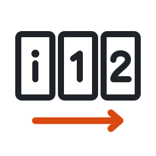

# PageSequence

A table of contents is written with the page numbers printed in the publication: "Grottor i
Värmland, s. 20–21". The PDF of that publication rarely numbers its pages the same way. It may have
an unnumbered cover, roman front matter, an insert with its own numbering, a missing page, or a
spread scanned as one PDF page.

A **page sequence** is a short string that says which labels are printed on each page of the PDF.
With it, a reference such as `"20-21"` is turned into the right PDF pages, and each PDF page can
be shown with the label printed on it. References are always written in labels, never in PDF page
numbers.

PageSequence is part of [publication-md](https://github.com/publication-md).

## The notation

- `,` separates PDF pages, and `-` is a range of PDF pages with one label each.
- `+` joins the labels on one PDF page, such as a spread scanned as one page.
- `..` is a run of PDF pages with several labels each.
- `!` marks an ignored PDF page, such as a duplicate scan.
- A label that contains a space or a reserved character is quoted: `"Omslag, insida"`.

| Sequence | The PDF |
|---|---|
| `1-52` | 52 pages, numbered 1 to 52 |
| `1, 2+3..46+47, 48` | a born-digital issue: the cover, 23 spreads, the back cover |
| `"Omslag", i-iv, 1-48` | an unnumbered cover, roman front matter, then pages 1 to 48 |
| `1-20, A-H, 21-40` | eight plates, lettered A to H, after page 20 |
| `1-25, 26+27, 28-52` | a centre spread scanned as one PDF page |
| `1-5, !3, 6-10` | page 3 scanned twice; the second scan is ignored |

The full format is in [`spec/pagesequence.md`](spec/pagesequence.md).

## Status

**v2 is in development.** It is not published yet, and the format is a draft until v2 is released.

- v2 will be published as `@publication-md/pagesequence` on npm and JSR, and as `pagesequence` on
  PyPI.
- v1 is [`@tvartom/pagesequence`](https://jsr.io/@tvartom/pagesequence) on JSR. Its code is on the
  branch `v1` and the tag `v1.3.3`.

## Documents

- [`spec/pagesequence.md`](spec/pagesequence.md): the format and the API.
- [`pagesequence-v2.md`](pagesequence-v2.md): the design of v2, its reasons, and the move from v1.
- [`ROADMAP.md`](ROADMAP.md): the work for building v2, phase by phase.

## Licence

The code is under the [MIT licence](LICENSE). The format description in `spec/` is under
[CC0](LICENSE-SPEC).
